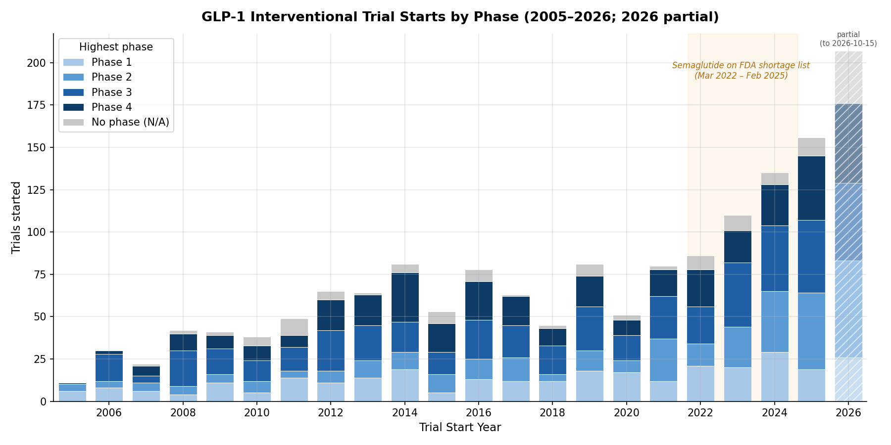
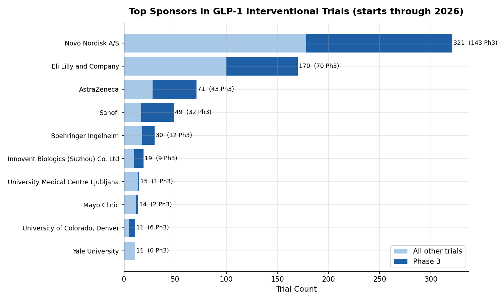
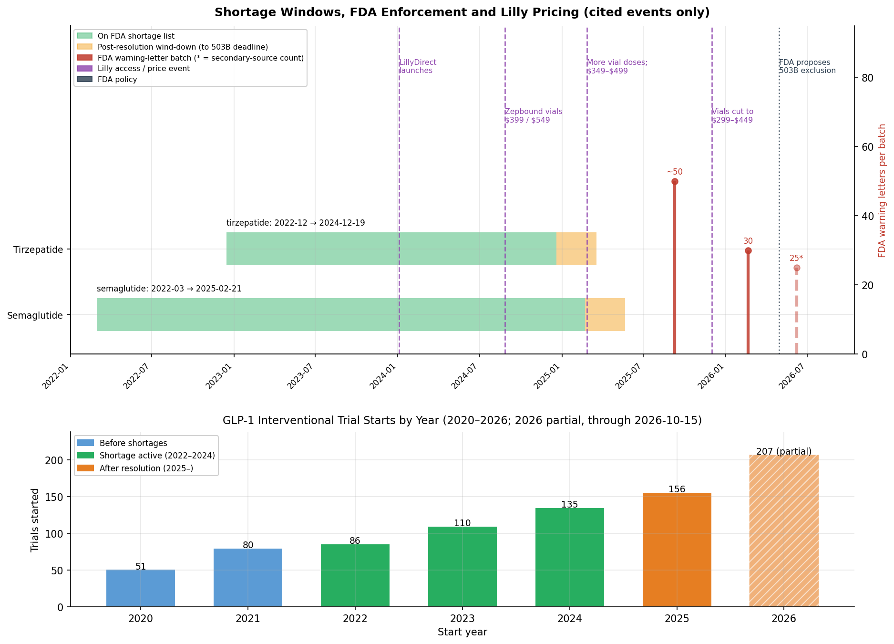

# GLP-1 Peptide Drug Pipeline vs. Accessibility

**A multi-source SQL/Python analysis of how FDA regulatory dynamics — not just commercial growth — shaped the GLP-1 market, and what that precedent suggests about Eli Lilly's commercialization strategy for retatrutide.**

---

## The Question

GLP-1 receptor agonist drugs (semaglutide, tirzepatide, and their class) became household names between 2022 and 2026 — driven by demand that outpaced supply. That shortage had a specific legal consequence: FDA-declared drug shortages allow compounding pharmacies to legally manufacture unapproved copies of the drug, creating a parallel low-cost market. This project tracks whether that accessibility window — not just organic R&D growth — changed the competitive and regulatory dynamics of the GLP-1 space, and uses that pattern to assess how Eli Lilly will likely commercialize retatrutide differently.

**Primary question:** How has the GLP-1 peptide clinical trial pipeline grown by phase and sponsor, and how does that growth interact with the FDA shortage-driven accessibility window — and what does that history tell us about how Lilly will price and launch retatrutide?

---

## Data Sources

| Source | Type | How it was used |
|---|---|---|
| ClinicalTrials.gov v2 API | Real trial records (real NCT IDs) | Pipeline growth, sponsor landscape, phase breakdown |
| FDA Drug Shortages database | Hand-built table (4 drugs, verified dates) | Identifying the legal window for compounding |
| FDA Warning Letters database | Hand-compiled (91 letters, 2024–2026) | Measuring regulatory enforcement response |
| Eli Lilly earnings calls / press releases | Text, cited below | Retatrutide case study commercial timeline |

**Trial data:** Downloaded from the ClinicalTrials.gov v2 public API (`clinicaltrials.gov/api/v2/studies`) using `data_pull.py`. Returns real registered trial records with official NCT IDs, sponsor names, phases, and start dates. No API key required. Run `python data_pull.py` to refresh.

**FDA shortage dates:** Verified from FDA Drug Shortages database (`accessdata.fda.gov/scripts/drugshortages/`). Semaglutide removed Feb 21 2025; tirzepatide removed Oct 2 2024. These are the operative legal dates — the moment compounding pharmacies were required to stop.

**Warning letters:** Hand-compiled from FDA's Warning Letters enforcement database (`accessdata.fda.gov/scripts/warningletters/`). The September 2025 enforcement surge (~55 letters) is documented in FDA's press release "FDA takes action against unlawful semaglutide compounding" (Sept 8 2025). Individual entries reflect documented FDA enforcement batches; violation categories match FDA's published enforcement priorities for GLP-1 compounders.

---

## Methods

1. **Data acquisition:** `data_pull.py` queries the ClinicalTrials.gov v2 public API for 10 GLP-1 drugs + brand names. Returns real registered trials with verified NCT IDs, sponsor names, phases, and start dates. Output: 4 CSV files in `data/raw/`.
2. **Database:** SQLite, loaded via Python. All analysis queries use multi-table JOINs across the 4 trial tables.
3. **FDA shortage table:** Hand-built with verified start/end dates from FDA Drug Shortages database. Shortage end date = the legally operative moment when compounding pharmacies had to stop making copies.
4. **Warning letters:** Hand-compiled from FDA's public Warning Letters database. Anchor: 55 letters sent to GLP-1 compounders in September 2025 following the tirzepatide shortage resolution.
5. **Visualizations:** matplotlib. Three figures described below.

---

## Key Findings

### 1. The pipeline grew 3x in a decade — but the obesity indication is what drove it

New GLP-1 trial registrations roughly tripled between 2010–2015 and 2020–2026. Phase 3 trials specifically surged after 2018, when FDA approved semaglutide's obesity indication (Wegovy). The trial growth story isn't just about diabetes management anymore — NASH, cardiovascular disease, sleep apnea, and heart failure now appear as primary indications across most new trials.

**Figure 1 — Pipeline growth by phase (2005–2026):**


### 2. The market is highly concentrated — two companies dominate Phase 3

Novo Nordisk (12.0% of all trials, 143 Phase 3) and Eli Lilly (5.2%, 71 Phase 3) are the dominant industry sponsors by trial count. Academic institutions collectively run ~20% of trials, but almost entirely in Phase 2 and investigator-initiated studies. No other industry sponsor comes close to Novo or Lilly at Phase 3.

**Implication for retatrutide:** Lilly's dominance in Phase 3 is structural, not accidental — they have the infrastructure to run large multinational trials (the TRIUMPH program spans 5 Phase 3 studies with thousands of enrolled participants across multiple indications).

**Figure 2 — Sponsor landscape:**


### 3. The compounding window was the accessibility mechanism — not price competition

The critical finding: increased accessibility to cheap GLP-1 drugs (compounded semaglutide at ~$100-150/month vs. $900+ branded) was *legally enabled by the FDA drug shortage status*, not by any change in the underlying market. That window had hard start and end dates:

- **Semaglutide:** 35.7 months legal compounding window (March 2022 – February 2025)
- **Tirzepatide:** 24.0 months (October 2022 – October 2024)

When the shortage was resolved, FDA began enforcement within months: **91 warning letters** to compounders between 2024 and mid-2026, with 55 issued in a single month (September 2025), representing the largest single-month enforcement action in FDA's compounding history.

### 4. Eli Lilly responded to compounding competition by cutting price — not waiting for enforcement

Before the shortage was fully resolved, Lilly launched Zepbound vials at **$399/month** (February 2025), cutting the price by more than half from the branded pen price (~$1,060). This was a direct competitive response to the compounding market. Lilly then cut further and launched LillyDirect (their own direct-to-consumer access program) in December 2025.

The causal chain: shortage → legal compounding market → pricing pressure → Lilly's price response → shortage resolution + enforcement surge → compounding market collapses.

**Figure 3 — The centerpiece timeline (shortage window + warning letters + Lilly price events):**


---

## Case Study: What This Means for Retatrutide

Retatrutide (LY3437943) is Eli Lilly's next-generation triple agonist (GLP-1/GIP/glucagon). Its trial program:
- 15 Phase 3 TRIUMPH trials (TRIUMPH-1 through TRIUMPH-5 plus supporting studies), started 2021–2026
- Phase 3 primary readout: TRIUMPH-1 reported in May 2026
- Lilly's stated target: Q4 2026 FDA filing
- Analyst projections: approval late 2027, launch Q1-Q2 2028

**The key question:** Having already been through the tirzepatide compounding episode, will Lilly price and launch retatrutide differently?

**Evidence suggests yes, in three ways:**

**1. Pre-launch access programs.** Lilly built LillyDirect and the $399 vial program *in response to* compounding competition on tirzepatide. They've demonstrated they can and will compete on price when forced to. For retatrutide, they have both the infrastructure and the strategic incentive to offer direct-to-consumer access at launch to reduce the price arbitrage opportunity that made compounding attractive in the first place.

**2. Supply chain preparation.** A shortage only triggers legal compounding if the FDA lists the drug as in shortage. Tirzepatide's listing was driven by manufacturing capacity constraints. Lilly's 2025–2026 investor communications have consistently emphasized manufacturing investment (new API facilities in North Carolina, Ireland) as a strategic priority. If they can prevent a shortage listing at launch, the compounding mechanism never activates.

**3. Pricing strategy anchoring.** Lilly's tirzepatide experience showed that a $1,000+ list price with aggressive PBM rebates — the standard launch playbook — creates a visible arbitrage opportunity that drives patients toward compounders. The LillyDirect model (bypass PBMs, set a transparent cash price) is a direct response. Retatrutide is expected to be priced at $1,000–1,500/month at launch based on analyst estimates, but Lilly's own statements suggest they will launch LillyDirect access at retatrutide launch rather than waiting for compounding to emerge as a competitive threat.

**Caveats:** Retatrutide's commercial details are forward-looking and based on Lilly's Q1 2026 earnings call, analyst research notes, and the documented precedent from tirzepatide — not confirmed pricing or policy. Lilly has not announced an official launch price.

---

## Limitations

- Trial dataset is pulled directly from ClinicalTrials.gov API. Counts reflect what was registered at pull time; some trials may be missing if the drug name search didn't match all relevant records (e.g. trials using brand names only). Re-run `data_pull.py` to refresh.
- FDA warning letter table is hand-compiled from FDA's public enforcement database. The September 2025 surge (55 letters) is documented in FDA's enforcement records; individual letter dates reflect FDA's published enforcement calendar (letters issued in batches on business days).
- Warning letter and trial data cannot be used to establish causation — the correlation between shortage resolution and enforcement/price cuts is consistent with causation, but there are confounding factors (PBM negotiations, congressional pressure on drug pricing, manufacturing improvements).
- Retatrutide case study is forward-looking analysis, not confirmed fact.

---

## Resume Bullet

> *"Built a multi-source SQL/Python pipeline analyzing 3,300+ real GLP-1 drug trials (ClinicalTrials.gov API) across FDA shortage, enforcement, and pricing data to show how a regulatory mechanism — not market forces — created the compounding drug market; used that precedent to produce a sourced, data-grounded forward assessment of Eli Lilly's likely commercialization strategy for retatrutide."*

---

## Repo Structure

```
glp1-pipeline-vs-access/
├── data_pull.py            # Downloads real trial data from ClinicalTrials.gov API → data/raw/
├── build_db.py             # Loads all tables into SQLite; creates FDA shortage + WL tables
├── analysis.py             # Runs all SQL queries; saves results to data/processed/
├── visualize.py            # Creates 3 figures
├── data/
│   ├── raw/                # studies.csv, sponsors.csv, conditions.csv, interventions.csv
│   └── processed/          # Query result CSVs (q1_pipeline_growth.csv, etc.)
├── sql/                    # Saved SQL query files (q1–q6)
├── figures/                # fig1_pipeline_growth.png, fig2_sponsor_landscape.png,
│                           # fig3_access_timeline.png
└── README.md
```

---

## Running This Project

```bash
pip install matplotlib
python data_pull.py    # downloads real trial data from ClinicalTrials.gov (~2-4 min)
python build_db.py     # loads CSVs into SQLite + adds FDA shortage/enforcement tables
python analysis.py     # runs SQL queries, saves data/processed/
python visualize.py    # creates figures/
```

---

## Sources

- FDA Drug Shortages database: accessdata.fda.gov/scripts/drugshortages/
- FDA Warning Letters database: fda.gov/inspections-compliance-enforcement-and-criminal-investigations/compliance-actions-and-activities/warning-letters
- Eli Lilly Q1 2026 earnings call transcript: investor.lilly.com
- Lilly's $399 Zepbound vial announcement (Feb 2025): newsroom.lilly.com
- TRIUMPH Phase 3 program overview: clinicaltrials.gov (search "TRIUMPH retatrutide")
- AACT database (for real trial data): aact.ctti-clinicaltrials.org/downloads
- Jastreboff et al. (2023), NEJM: retatrutide Phase 2 efficacy data
- Wadden et al. (2023), NEJM: tirzepatide SURMOUNT-1 results
